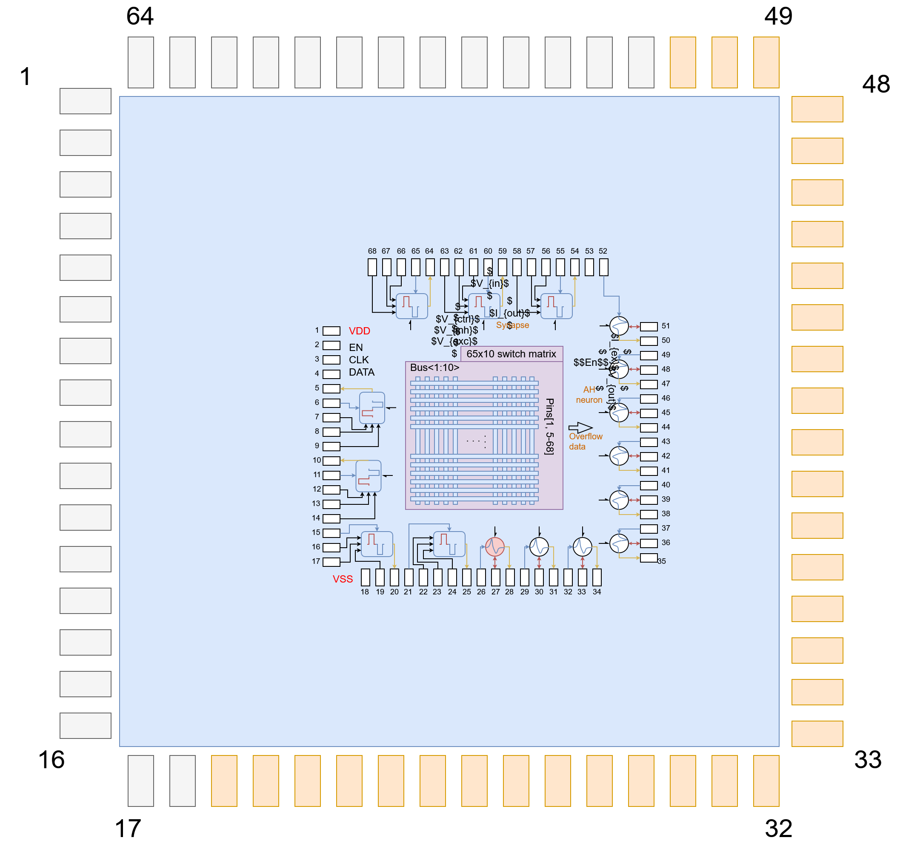

# Integration padframe 2025 sscs Chipathon

This repo contains individual designs and integration from the teams on the MOSbius_2 track (die number 2 on the same topic of mosbius).

## Project Directory Structure
```
project-root/
├── Padframe_designs/                  # Individual teams designs 
├── Padframe_submission                # Submission for the integrated padframe
│   ├── Chipathon2025_3_padring.gds/   # GDS for the padframe
│   ├── final_m2track.gds/             # GDS for the integrated padframe for photolitography (no library info)
│   ├── final_m2track.zip/             # zip for the GDS for the integrated padframe for photolitography
│   ├── re_chip_m2track.gds.gds/       # GDS for the integrated padframe
│   └── re_m2track.zip/                # zip for the GDS for the integrated padframe
├── fill_cells                         # Cells to create dummy filling, Metal 1-5, comp + poly, and comp only
├── render                             # Magic render of the final chip submission
├── review                             # DRC results
└── README.md                          # This file
```

## Teams designs
The individual designs on the chip die have this specs:
- M2 Chip Odyssey: TIA (bottom), Comparator and SAR logic (top) (5MHz clock). Repo [link](https://github.com/miakadam/Wk_Chip_Odyssey)
- M3 CreActive: Active Filter Building Blocks (6 OTAs, 6 Capacitors, 12 Resistors). Repo [link](https://github.com/assaify/creactive-chipathon-2025)
- M9 Prof Morbius: 900MHz ISM Radio: 902–928 MHz tuning range with ideally 150 hop frequency & 50 channels. Repo [link](https://github.com/orpheus016/prof-morbius-rf-chip)
- M10 RAZAVUS: PGA with a gain range from 2.5dB to 80dB (1 OTA, 1 res ladder) [link](https://docs.google.com/presentation/d/100o6kI8j3Z_EshEqWcP3buRbBRCfHR6Fv54dOGRp1Uo/edit?usp=drivesdk)
 [links](https://github.com/polarwave/SSCS-Chipathon-2025-VGA)
- M13 SpikCore: Neuromorphic chip with analog neurons(1 LIF, 5 AH); 6 synapses and 1 bootstrapped TG. Repo [link](https://github.com/RoyceRichmond/Mosbious_2025_Spikcore)

## Final GDS render


## Boding diagram

In the Asic we have available from pin 19-51, the pinout is show below

| IO Number | Cell |
|-----------|------|
| 19        | Vout synapse 6    |
| 20        | Vin synapse 6     |
| 21        | Vout synapse 5    |
| 22        | Vin synapse 5     |
| 23        | Vout synapse 4    |
| 24        | Vin synapse 4     |
| 25        | Vout synapse 3    |
| 26        | Vin synapse 3     |
| 27        | Vout synapse 2    |
| 28        | Vin synapse 2     |
| 29        | Vout synapse 1    |
| 30        | Vin synapse 1     |
| 31        | V_inhibitory synapses |
| 32        | V_excitatory synapses |
| 33        |  V_bias AH neurons |
| 34        |  Current_in_AH 1   |
| 35        |  Vout_AH       1   |
| 36        |  Current_in_AH 2   |
| 37        |  Vout_AH       2   |
| 38        |  Current_in_AH 3   |
| 39        |  Vout_AH       3   |
| 40        |  Current_in_AH 4   |
| 41        |  Vout_AH       4   |
| 42        |  Current_in_AH 5   |
| 43        |  Vout_AH       5   |
| 44        |  Vin_LIF    |
| 45        |  Vout_LIF    |
| 46        | Data_in config     |
| 47        | Clk config     |
| 48        | Enable config     |
| 49        | clk TG bootstrapped     |
| 50        | VDD     |
| 51        | VSS     |
|56       |vin TG bootstrapped|
|57       |vout TG bootstrapped|

pin 45 (Vout_LIF) is connected to the first row of the sw matrix
pin 46 (vin_LIF) is connected to the second row of the sw matrix

The same pattern continues for the complete 24 rows, the sw matrix has 10 colums (which act as the internal connections)


There is an aditional 10bits on the final part of the sw matrix that determines the state of the synapses (6 for the synapses, the other 4 bits are not wired to anything)



## Documentation

For the comp and dummy filling some guidance can be found [here](https://docs.google.com/document/d/19A6Ne7opWf_n_TiCbm6itnKisTnPMyoWfHkXmfdlzS0/edit?tab=t.0#heading=h.364crm57j2pt)

The documentation for Global foundry PDK can be found [here](https://gf180mcu-pdk.readthedocs.io/), the easiest way to find the error is to look for layers and then the specific error, in the case of metals is marked ad Mn.1 where n is the metal, search for Mn.1 of Mn.3 instead of M2.1 or M2.3 this would not return good results and could confuse some people

be aware of this option for final gds [submission](https://github.com/IHP-GmbH/TO_Sep2025/issues/5)


for padframe check [this](https://github.com/wafer-space/gf180mcu-project-template?tab=readme-ov-file#building-a-standalone-padring-for-analog-design) and zero size [geometry](https://docs.google.com/document/d/1nUc_582qBiCu-naZLkHyvrfL3f4m-krewwwFoDorsRU/edit?tab=t.0#heading=h.vtvu7lb20p8m)
